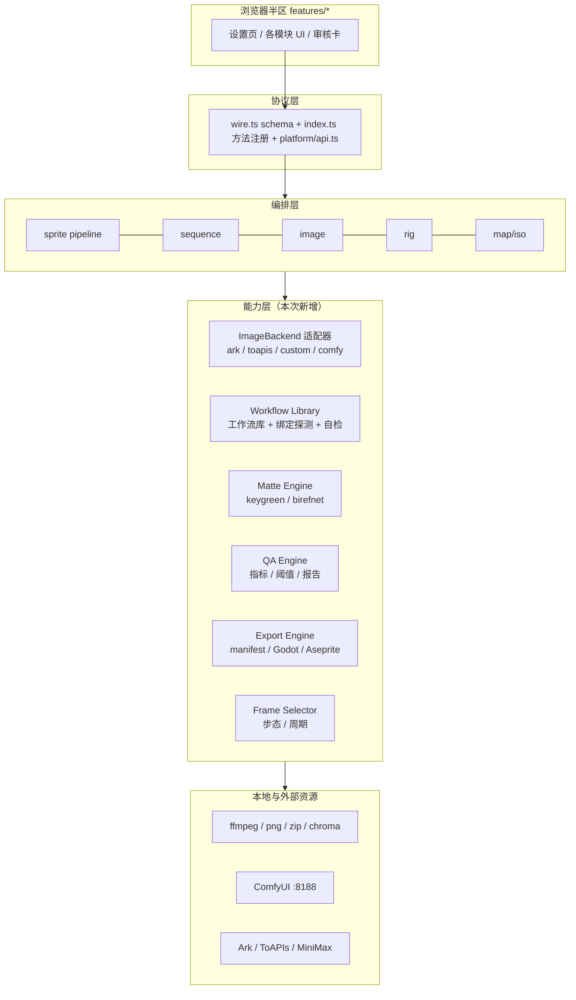

# 墨盒 × 本机 skill 能力合并 · 重构设计

- **状态**：待评审（设计文档，不改产品代码）
- **日期**：2026-10-29
- **基线**：分支 `refactor/client-module-split`，HEAD `1553dec`（工作区另有 0.12.0 发布准备改动）
- **关联需求**：
  - 总控 `req_dfd6949fc0`（墨盒吸收本机 skill 生图能力）
  - 本设计 `req_68dd238e2f`
  - 实施子需求：工作流库 `req_e395dcba0d`、BiRefNet 去背 `req_59a3b50652`、产物 QA `req_aee289460b`、引擎导出 `req_b70a5d20bb`、自动选帧 `req_2e421741df`、互操作 `req_7180b0d06a`
- **上游依据**：`G:\image` 三套 skill（`comfyui-2d-assets`、`minimax-h3-walk-cycle`、`sprite-gen` v2.44.0）与墨盒 0.11.0 的对比结论（见对话与各自 SKILL.md）
- **硬约束（不可破）**：零运行时依赖、`lib/client.js` 是经典脚本、wire 只做增量、宿主改动需重启 DSH、一切生成类调用必须走既有计费/幂等护栏

---

## 0. 摘要

合并的目标不是「把 Python 脚本塞进插件」，而是把 skill 里已经被实测证明有效的**能力**用 TypeScript 重实现，并挂到墨盒已有的项目/任务/审核/计费骨架上：

1. **本地 ComfyUI 升为一等生图后端**，带「工作流库」（9 个实测工作流按用途选，任务级选择，绑定自动探测，缺失明确报错）；
2. **去背抽象**：绿幕（现有）与 BiRefNet（模型）双后端，失败显式回退；
3. **产物 QA**：透明比例、彩边、包围盒/身高一致性、循环缝等硬指标，出报告；
4. **引擎导出**：manifest + Godot SpriteFrames + Aseprite JSON；
5. **自动选帧**：步态/周期分析替代等分+手选；
6. **互操作**：工作流导入、批量/本机路径导入。

所有能力都设计成**可独立开关、可独立回滚**的层，默认不改变现有用户路径（additive-only）。

---

## 1. 现状盘点（as-is）

### 1.1 生图链路现状

| 层 | 现有实现 | 关键事实 |
|---|---|---|
| 分发 | `src/imageprovider.ts` 的 `generateImageWithProvider` | 所有生图调用点唯一入口；当前 `if` 链分派 `ark` / `toapis` / `custom` |
| 云端 | `src/ark.ts`（Seedream）、`src/toapis.ts` | 付费，`receipts.beginPaidCall` + `withSlot("paid")` |
| 自定义 | `src/customimage.ts`（OpenAI / ComfyUI / SD WebUI） | ComfyUI 只支持**一份全局工作流** + `{{prompt}}` 等占位符；无占位符时提示词被静默忽略 |
| 视频 | `src/videogen.ts` + `src/minimax.ts` / `src/comfy.ts` | `comfyVideo` 布尔开关接管视频；`comfy.ts` 已有 API/界面格式解析、绑定探测、首/尾帧注入 |
| 本地处理 | `src/media.ts`（ffmpeg）、`src/chroma.ts`（绿幕+合图）、`src/png.ts`、`src/zip.ts` | 抽帧/抠像/像素化/合图/打包全在本地 JS，零依赖 |
| 编排 | `src/pipeline.ts`（①②）、`src/seqgen.ts`（③）、`src/riggen.ts`（④） | 固定阶段、任务表 `src/jobs.ts`、付费 receipt |
| 协议 | `src/wire.ts`（zod schema 清单）+ `src/index.ts`（方法注册）+ `src/client/platform/api.ts`（读写/付费分类） | typert 按 schema 校验，**schema 里没有的键会被静默丢掉** |

### 1.2 与 skill 的差距（合并要补的）

| 能力 | skill 侧 | 墨盒现状 |
|---|---|---|
| 本地工作流目录 | 9 个工作流 + 模型清单 + `check.cmd` 自检 | 只有一份全局 ComfyUI JSON |
| 模型级去背 | BiRefNet（约 1.35 s/帧） | 仅绿幕色彩/洪水填充 |
| 产物硬指标 | 身高/头宽 CV、左右脚交替、周期自证、循环缝、交付 fail-closed | 只有 `backgroundFraction` + 人眼 |
| 引擎导出 | manifest.frame_layout、Godot SpriteFrames、Aseprite、game-pack | 仅 PNG/zip（rig 模块例外） |
| 自动选帧 | 步态 contact/passing + 自相关周期 | 等分 + 手选 |
| 素材导入 | 脚本吃任意本地路径 | 主要靠 base64 上传 |

### 1.3 现有硬约束清单（设计必须逐条满足）

1. **零运行时依赖**：不新增 npm 依赖；一切外呼走 `fetch`/`spawn`。
2. **客户端单文件经典脚本**：`lib/client.js` 由 esbuild 内联，无 `import/export`；React 元素用 `h()`；体积预算 1.2 MB（gzip 320 KB）。
3. **客户端四层依赖单向**：`shell → features → platform`，features 之间零 import。
4. **wire 增量**：不改既有方法名/字段语义；新 payload 键必须写进 `src/wire.ts` 的 schema。
5. **付费三处清单一致**：`src/index.ts` `PAID_METHODS`、`src/wire.ts` `withPaidFields`、`src/client/platform/api.ts` `PAID_METHODS`。**本地能力不进付费清单**。
6. **新增配置字段必须进 `saveConfig` 的 `directKeys` 白名单**（凭据类字段除外，单独 trim）。
7. **隐藏模块双向拦截**：界面 + 工具面。
8. **所有文案 `T()` + `i18n-en.ts` 词条**；模块级文案表进 `staticTextRebuilders`。
9. **轮询不得覆盖草稿**：`mergeDrafts()`。
10. **宿主半区改动需重启 DSH**，产物需在发布说明写明。

---

## 2. 目标架构（to-be）

### 2.1 分层总图



**分层原则**

- **能力可声明**：每个后端/引擎都实现统一接口并暴露 `capabilities`（是否本地、是否付费、支持什么），编排层不再写 `if (provider === ...)` 散点。
- **任务级选择**：能力的选择落在 `job.settings` 或项目设置上，不只有一个全局开关；全局配置只提供默认值。
- **失败显式回退**：本地能力不可用/超时时，明确回退到现有通道，并把「用了谁、为什么回退」写进任务日志和报告，禁止静默降级。
- **本地免费 ≠ 付费**：本地（ComfyUI/自带算法）走 `local` 并发 lane，不产生 receipt，也不进 `PAID_METHODS`。
- **additive-only**：旧配置、旧任务、旧 wire 客户端不受影响；新字段全部 optional。

### 2.2 新增文件规划

| 文件 | 职责 | 所属子需求 |
|---|---|---|
| `src/imagebackend.ts` | 后端接口、能力声明、适配器注册与选择策略 | 工作流库 |
| `src/workflowlib.ts` | 工作流库 CRUD、导入/导出、绑定解析、内置目录 | 工作流库 |
| `src/workflowbuiltin.ts` | 9 个内置工作流的 JSON（或引用文件） | 工作流库 |
| `src/matte.ts` | 去背抽象、keygreen 适配、BiRefNet 调用、回退 | BiRefNet |
| `src/qa.ts` | 指标计算（纯 RGBA）与报告 | 产物 QA |
| `src/exportman.ts` | manifest / Godot / Aseprite 生成与逐帧校验 | 引擎导出 |
| `src/cycle.ts` | 步态/周期分析与选帧 | 自动选帧 |
| `src/interop.ts` | 路径/批量导入、工作流导入的共享校验 | 互操作 |

> 客户端新增 UI 优先落在现有 `features/<module>/index.ts` 与 `src/client/config-section.ts`；只有跨模块复用的组件才进 `shell/components`。避免新增跨 feature import（verify-arch 会拦）。

---

## 3. 后端抽象（Provider）

### 3.1 接口

```ts
// src/imagebackend.ts（新）
export type ImageBackendKind = "ark" | "toapis" | "custom" | "comfy";

export interface ImageBackendCapabilities {
  kind: ImageBackendKind;
  label: string;
  /** 本地后端走 local lane，不产生 receipt。 */
  local: boolean;
  paid: boolean;
  /** 支持参考图张数，0 = 不支持。 */
  maxReferenceImages: number;
  /** native = 模型直接出 alpha；keyed = 需要绿幕后处理；none = 无透明能力。 */
  transparency: "native" | "keyed" | "none";
  /** 是否支持工作流库（ComfyUI）。 */
  workflowLibrary: boolean;
  /** 自检是否真的出图（本地免费可以真出；云端用最小尺寸）。 */
  selfTestGenerates: boolean;
}

export interface ImageGenerateRequest {
  prompt: string;
  negativePrompt?: string;
  images: string[];              // data URI 或 http(s) URL
  size: string;
  watermark: boolean;
  model?: string;
  workflowId?: string;           // 仅 workflowLibrary 后端
  steps?: number;
  cfgScale?: number;
  sampler?: string;
  denoising?: number;
  seed?: number;
  timeoutMs?: number;
}

export interface ImageGenerateResult {
  bytes: Buffer;
  ext: string;
  /** 给日志/回执用的附加信息（不含密钥）。 */
  usage?: { seed?: number; workflowId?: string; promptId?: string; filename?: string };
}

export interface ImageBackend {
  readonly capabilities: ImageBackendCapabilities;
  /** undefined = 可用；字符串 = 给人看的原因（去哪配）。 */
  blocker(config: Config): string | undefined;
  generate(config: Config, request: ImageGenerateRequest, signal?: AbortSignal): Promise<ImageGenerateResult>;
  selfTest(config: Config, signal?: AbortSignal): Promise<{ ok: true; detail: string } | { ok: false; reason: string }>;
}

export function resolveImageBackend(config: Config): ImageBackend;
```

**约束**：`generateImageWithProvider` 保持为唯一门面（现有调用点零改动）；门面内部换成 `resolveImageBackend(config).generate(...)`。

### 3.2 四个适配器

| kind | 复用 | 本地/付费 | 说明 |
|---|---|---|---|
| `ark` | `src/ark.ts` | 云端付费 | 现有默认，receipt 不变 |
| `toapis` | `src/toapis.ts` | 云端付费 | 现有逻辑不变 |
| `custom` | `src/customimage.ts` | 取决于服务 | OpenAI / SD WebUI；ComfyUI 保留兼容（见迁移） |
| `comfy`（新） | `src/comfy.ts` + 工作流库 | 本地免费 | 每次请求必须带 `workflowId` 或由用途映射默认值 |

**新增设置项**：`imageProvider` 枚举追加 `"comfy"`；旧的 `imageProvider: "custom" + customProtocol: "comfyui"` 继续可用（视为「自定义 ComfyUI」兼容路径，设置页提示可迁移到工作流库）。

### 3.2.1 支持矩阵：本地与远程并存，远程不绑定厂商

**本地**

| 方式 | 支持 | 说明 |
|---|---|---|
| 本机 ComfyUI（图像 + 视频） | ✅ | 任意模型 / 自定义节点 / 任意工作流 JSON；9 个内置条目只是「目录种子」，导入与改写都不受限 |
| 本机 Stable Diffusion WebUI | ✅ | `customProtocol: "sdwebui"` |
| 任意 OpenAI 兼容的本地服务 | ✅ | `customProtocol: "openai"`（本地网关 / 兼容层都行） |
| 插件内嵌推理引擎 | ❌ | 不打包模型与推理运行时；本地模型装在外部队列（ComfyUI 等）里 |

**远程（图像）**

| 方式 | 支持 | 说明 |
|---|---|---|
| 火山方舟 Seedream | ✅ 内置 | 默认后端，receipt/幂等不变 |
| ToAPIs | ✅ 内置 | 异步任务 + 内部 receipt |
| 任意 OpenAI 兼容服务 | ✅ | 改 `baseUrl` / Key / 模型即可换厂商（含官方、云厂商兼容层、第三方网关） |
| 任意 ComfyUI（本机 / 云上 / 反代鉴权） | ✅ | 工作流库 + `comfyCookies`；不要求同机 |
| 任意 Stable Diffusion WebUI | ✅ | `--api` 启动即可 |
| 私有协议厂商（Stability / Replicate / Midjourney 等） | ⚠️ 不直接支持 | 需新增 adapter（§3.5），或走它们的 OpenAI 兼容网关 |

**远程（视频）**

| 方式 | 支持 | 说明 |
|---|---|---|
| MiniMax（H3 / Hailuo / 优云智算） | ✅ 内置 | 默认视频后端 |
| ToAPIs 视频 | ✅ 内置 | `toapisVideo` |
| ComfyUI（本机 / 远程） | ✅ | `comfyVideo` + 工作流 |
| 其他视频厂商 | ⚠️ 需 adapter | 同 §3.5 |

**边界要说清**

- 「支持哪一家」= 「支持哪一类协议」。同一协议内换厂商只改 baseUrl / Key / 模型，不改代码；协议之外的私有 API 才需要适配器。
- 本地与远程**同时保留**：`imageBackendPolicy` 只决定默认走谁，回退目标是云端；关掉本地不影响云端路径，反之亦然。
- 选择粒度：全局默认（`imageProvider`）+ 任务级覆盖（设计预留 `job.settings.provider`，与工作流选择同层）；首版至少保证全局可切 + 本地工作流任务级可选。
- 凭据只落本机 `config.json`，界面与工具面都不回传明文。

### 3.3 选择与回退策略

- `imageBackendPolicy: "manual" | "local-first"`（新配置，默认 `manual`）。
- `manual`：走 `imageProvider` 指定的后端，行为与今天一致。
- `local-first`：先探测 `comfyBaseUrl` 的 `/system_stats`；可用且指定工作流就绪 → 本地；否则记录原因并回退 `ark`（或 `custom`），**界面必须显示回退原因**。
- 探测失败缓存 30 秒，避免每张图都等超时。

### 3.4 计费与并发

- `ark` / `toapis`：保持 `withSlot("paid")` + receipt。
- `comfy` / 自带算法：`withSlot("local")`，不建 receipt。
- 新增 `verify-workflow-lib.mjs` 断言「本地后端提交不写 receipts」。

### 3.5 新增厂商 / 协议的扩展点

- **图像**：实现一个 `ImageBackend`（`blocker` / `generate` / `selfTest` + `capabilities`），在 `imagebackend.ts` 注册；配置只加 provider 枚举值与少量字段。
- **视频**：实现 `VideoBackend` 分支（`submitVideoTask` / `queryVideoTask` / `downloadVideoTask`），节点上记录 `backend`（现有兼容字段，查询按节点走，不按当前配置）。
- **协议复用**：能走 OpenAI 兼容 / ComfyUI / SD WebUI 的厂商无需写 adapter，改配置即可；私有协议才需要新代码。
- **计费**：付费厂商在 adapter 内 `beginPaidCall`；本地厂商不建 receipt；三处清单只在真的新增付费方法时同步。
- **自检**：新增 `verify-<vendor>.mjs`，起本地假服务端验证端点与错误路径（离线零付费）。
- **约束**：adapter 不引第三方运行时依赖；所有请求走现有 `fetch` + 超时/取消封装。

---

## 4. 工作流库（Workflow Library）

### 4.1 数据模型

```ts
// src/workflowlib.ts（新）
export type WorkflowKind = "generate" | "post"; // post = 去背/像素化/拼图这类非生图工作流
export type WorkflowProtocol = "api" | "ui";

export interface WorkflowBindings {
  prompt?: string;     // "节点ID.输入名"
  negative?: string;
  width?: string;
  height?: string;
  seed?: string;
  image?: string;      // 参考图 / 输入图
  image2?: string;     // 第二张参考图（如姿势图）
  first?: string;      // 视频/动画首帧
  last?: string;
  batch?: string;
  steps?: string;
  cfg?: string;
  sampler?: string;
  denoising?: string;
}

export interface WorkflowEntry {
  id: string;                    // "wf_" + 短哈希
  name: string;
  purpose: string;               // 人读用途：透明精灵 / 像素风 / 无缝砖 / 去背 …
  kind: WorkflowKind;
  protocol: WorkflowProtocol;
  builtin: boolean;
  requiredModels: string[];      // 文件名字符串，用于自检提示
  bindings: WorkflowBindings;
  defaults?: { width?: number; height?: number; steps?: number; cfg?: number; sampler?: string };
  /** API 格式对象；界面格式在导入时已转换。 */
  workflow: Record<string, unknown>;
  createdAt: number;
  updatedAt: number;
  notes?: string;
}
```

**存储**：工作流正文落 `<DSH_HOME>/inkbox/workflows/<id>.json`（与 `config.json` 分离，避免配置膨胀与脱敏逻辑）；`config.json` 只存索引（id/name/purpose/kind/builtin）。索引与文件不一致时以文件为准并重建索引。

### 4.2 内置目录（9 个）

| id | 名称 | kind | 关键注入 | 依赖模型（自检提示用） |
|---|---|---|---|---|
| `builtin.transparent-qwen` | 透明精灵 Turbo | generate | prompt / size / seed | Qwen Turbo 底模 + 文本编码器 |
| `builtin.pixel-sdxl` | 像素风 SDXL | generate | prompt / negative / size / seed / steps / cfg | SDXL 1.0 + pixel-art-xl + BiRefNet |
| `builtin.pixel-sdxl-fast` | 像素风 SDXL 极速 | generate | 同上（8 步 LCM） | SDXL + pixel-art-xl + LCM LoRA |
| `builtin.lineart-control` | 线稿控制 | generate | prompt + 控制图（image） | Qwen + ControlNet Union |
| `builtin.pose-frame` | 角色动作帧 | generate | prompt + 参考图（image）+ 姿势图（image2） | Qwen + ControlNet Union |
| `builtin.matte-birefnet` | BiRefNet 去背 | post | image | background_removal/birefnet |
| `builtin.pixelize-post` | 像素化后处理 | post | image / size / colors | 无外部模型 |
| `builtin.tile-seamless` | 无缝地块 | generate | prompt / size / seed | Qwen + SeamlessTile/MakeCircularVAE 节点 |
| `builtin.sprite-grid` | 精灵表拼接 | post | image / batch / columns | 无外部模型 |

> 内置 JSON 存放方式见第 13 节待确认点 3（随包内置 vs 首次导入）。

### 4.3 绑定解析顺序（必须显式，不许静默）

1. `WorkflowEntry.bindings` 显式指定；
2. 工作流里的占位符（`{{prompt}}` 等），复用 `customimage.ts` 的 JSON 树替换；
3. 自动探测：复用 `comfy.ts` 的 `detectComfyBindings`（读 `/object_info`）；
4. 仍缺**关键绑定**（generate 工作流的 prompt / post 工作流的 image）→ 抛错 `workflow-binding-missing`，错误文案列出「候选节点 + 如何手工指定（节点ID.输入名）」。
5. 注：`detectComfyBindings` 目前在 `comfy.ts` 里是视频用；抽成共享函数（`comfy.ts` 导出即可，不改语义）。

### 4.4 自检与「测试连接」

- `GET /system_stats`：版本 / 显卡 / 显存 / 队列长度（只读，免费）；
- 模型存在性：`/object_info` 里 `CheckpointLoaderSimple` 等节点的 `ckpt_name` 选项与 `requiredModels` 求交；缺模型 → 列出缺哪些；
- 节点存在性：工作流里出现但 `/object_info` 没有的 `class_type` → 列出缺哪些自定义节点；
- 绑定识别结果：显示「prompt → 节点 6.text」等；
- 真出图测试：仅本地可选「跑一张 64×64 测试图」，默认不点。

### 4.5 任务级选择

- `ImageJob.settings.workflowId?: string`（新字段，旧任务缺省 = 用配置默认 `imageWorkflowId`，再缺省 = 按用途推荐）。
- 界面：模块②选「本地 ComfyUI」时出现工作流下拉（按 purpose 分组），并显示自检状态徽标。
- API：`getImageJob` 回包带 `workflowId` 与 `workflowStatus`。

---

## 5. 去背抽象（Matte）

### 5.1 接口

```ts
// src/matte.ts（新）
export type MatteBackend = "auto" | "keygreen" | "birefnet";

export interface MatteInput { rgba: Buffer; width: number; height: number; }
export interface MatteOptions {
  backend: MatteBackend;
  keying: KeyingSettings;        // 现有绿幕参数
  fallback: boolean;             // true = birefnet 失败回退 keygreen
  timeoutMs?: number;
}
export interface MatteResult {
  rgba: Buffer;
  backend: "keygreen" | "birefnet";
  fallbackReason?: string;
  elapsedMs: number;
}
export interface MatteEngine {
  matte(config: Config, input: MatteInput, options: MatteOptions, signal?: AbortSignal): Promise<MatteResult>;
}
```

- `keygreen`：直接调用现有 `src/chroma.ts` 的 `keyGreen`（零改动）。
- `birefnet`：上传 PNG → 提交 `builtin.matte-birefnet` → 轮询 `/history` → `/view` 取回。
  - **输出约定**：工作流最终必须输出带 alpha 的 IMAGE（`JoinImageWithAlpha` / `VAEDecode` 的 RGBA）。若只输出 MASK，则插件侧用 mask 与原图合成 RGBA（不依赖工作流必须含合成节点）。
  - 裁剪：去背前后尺寸必须一致；不一致直接报错（防止缩放过的小图覆盖原图）。
- `auto`：先 `keygreen` 判背景占比与边缘质量，若「背景占比 < 0.05 或边缘彩边严重」且 `birefnet` 可用 → 走模型；否则绿幕。首版建议默认 `keygreen`（行为不变），用户在设置里选 `birefnet`/`auto`。

### 5.2 批量与并发

- 按任务批量：一次处理**一帧或一小批（≤4）**，复用 ComfyUI 的 batch 输入（若工作流支持），否则逐帧提交但在 `local` lane 里受限并发（默认 2）。
- 超时：单帧 120 s，批次上限 `min(帧数 × 30s, 30min)`；超时按失败回退。
- 缓存：同图同参数的 matte 结果按内容哈希落 `keyed/` 复用，避免重复跑（免费但费时）。

### 5.3 接线点

| 模块 | 现有函数 | 改动 |
|---|---|---|
| ① sprite | `keyFrames` / `startRekey` / `startCompose` 内的 `keyGreen` | 换 `matteEngine.matte(...)`，默认 keygreen |
| ② image | `keyItem` / `rekeyImageJob` | 同上 |
| ③ sequence | `keySequenceFrames` | 同上 |
| ④ rig | `runRigSegment` 等若用抠像 | 只读接入，不强制 |

### 5.4 配置与报告

- `matteBackend: "keygreen" | "birefnet" | "auto"`（默认 `keygreen`）。
- `matteFallback: boolean`（默认 true）。
- job.json 节点新增 `matte: { backend, fallbackReason?, elapsedMs, at }`；任务日志写一行「去背后端 birefnet / 回退原因 …」。

---

## 6. 产物 QA

### 6.1 报告结构

```ts
// src/qa.ts（新）
export interface QAMetric {
  key: string;
  label: string;
  value: number;
  threshold?: number;
  comparison?: "max" | "min";
  verdict: "pass" | "warn" | "fail" | "info";
}
export interface QAReport {
  version: 1;
  scope: "sprite" | "sequence" | "image";
  frameCount: number;
  sampled: number;
  metrics: QAMetric[];
  issues: { code: string; message: string }[];
  verdict: "pass" | "warn" | "fail";
  thresholds: Record<string, number>;
  generatedAt: number;
  elapsedMs: number;
}
```

### 6.2 指标与口径（全部在 RGBA Buffer 上算）

| 指标 | 口径 | 默认阈值 | 判定 |
|---|---|---|---|
| `transparentRatio` | alpha<8 的像素占比（每帧平均与逐帧极值） | 0.05~0.95 | 越界 warn |
| `fringeRatio` | alpha 边缘（alpha 8~247 或相邻透明的前景像素）中绿色优势 `g-max(r,b)`>40 的占比 | ≤0.15 | 超阈 warn |
| `bboxCv` | 逐帧 alpha 包围盒宽/高的变异系数 | 宽 ≤5%、高 ≤1% | 超阈 warn |
| `heightCv` | 逐帧身高（bbox 高）CV，按 skill 的稳健口径（顶带覆盖宽度中位数辅助） | ≤1% | 超阈 fail |
| `headWidthCv` | 顶部 15% 行段最大行宽的中位数 CV | ≤2% | 超阈 warn |
| `loopSeamIou` | 末帧与首帧 alpha 掩码 IoU | ≥0.35 | 低于 fail |
| `loopSeamDiff` | 前景并集上的平均 RGB 差 | ≤24 | 超阈 warn |
| `centroidJitter` | 相邻帧质心位移的最大值 / 中位数 | 记录 | info |

- 与 minimax 实测阈值对齐（头宽 CV ≤2%、身高 CV ≤1%、交替 Δ ≥0.20、缝余量 ≥0.35），来源写进文档注释。
- **降采样**：长边 > 512 时先按盒式平均降到 512 再算，报告里记录 `sampled`。
- **交替指标**：依赖 `src/cycle.ts` 的脚位/步幅读数，QA 只在能算时给 `info`，不阻塞。

### 6.3 触发与展示

- 触发点：① 合成整图后、② 生成+抠像后、③ 合成条图后；可配置 `qaEnabled`（默认 true）。
- 存储：`<job>/qa/report.json`，`getProject` / `getImageJob` / `getSequenceJob` 回包带 `qa` 摘要（verdict + issues 前 5 条）。
- 界面：步骤条对应阶段显示「QA 通过 / 2 项警告 / 1 项失败」；展开见指标表；manual 审核模式下 QA 报告作为验收材料。
- 默认 **warning-only**（不阻断导出），`qaFailClosed: boolean` 可开（默认 false），开启后 fail 阻断下一步。

---

## 7. 引擎导出

### 7.1 manifest v1

```json
{
  "format": "inkbox-sprite@1",
  "name": "wudu-walk",
  "cell": { "width": 256, "height": 384 },
  "columns": 8,
  "rows": 8,
  "fps": 10,
  "loop": true,
  "pivot": { "x": 0.5, "y": 0.975 },
  "frameLayout": [
    { "index": 0, "row": 0, "column": 0, "x": 0, "y": 0, "w": 256, "h": 384, "durationMs": 100 }
  ],
  "directions": ["front", "downLeft", "left", "upLeft", "back", "upRight", "right", "downRight"],
  "source": { "projectId": "p...", "settings": { "...": "脱敏后的生成参数" } },
  "generatedAt": "2026-10-29T00:00:00.000Z"
}
```

- 帧顺序：行优先，行序 = 项目当前 `rowOrder`；每行一个方向；帧数 = `columns × rows`。
- 校验：`frameLayout.length === columns*rows`；矩形不越界、不重叠；与 PNG 实际尺寸一致；否则导出直接报错。

### 7.2 Godot SpriteFrames `.tres`

- 文本模板（`script_class="SpriteFrames"`）：每个方向一个动画（`front_walk` / `downLeft_walk` …），`speed = fps`、`loop = true`；
- 贴图为整图 PNG，`region` 用 manifest 的矩形；
- 附 `README.txt` 说明导入步骤与 pivot 换算。

### 7.3 Aseprite JSON

- `frames`: 每个方向的帧列表（`frame` 矩形、`duration`）；
- `frameTags`: 每个方向一个 tag；
- `meta.image` 指向 PNG（相对路径）。

### 7.4 导出入口与 zip

- 模块① 导出卡：内容多选（整图 PNG / 帧序列 / manifest / Godot / Aseprite / zip）；
- 模块③ 同形（单行动画）；
- zip 结构：`<name>/sprite-sheet.png`、`manifest.json`、`godot/<name>.tres`、`aseprite/<name>.json`、`frames/<dir>/f00.png…`；
- 文件名与现有 `out/` 约定兼容（`sprite-sheet.png` 沿用现有整图名）。

### 7.5 接口

```ts
// src/exportman.ts（新）
export type ExportFormat = "manifest" | "godot" | "aseprite";
export interface ExportInput { projectOrJob: SpriteExportSource; formats: ExportFormat[]; outDir: string; }
export interface ExportResult { files: string[]; manifest: Manifest; warnings: string[]; }
```

---

## 8. 自动选帧

### 8.1 接口

```ts
// src/cycle.ts（新）
export interface FrameSample { index: number; rgba: Buffer; width: number; height: number; }
export interface CyclePick {
  picks: number[];               // 均匀覆盖一个完整周期的帧下标
  confidence: number;            // 0~1
  period: number;                // 估出的周期（帧）
  contacts: number[];
  passing: number[];
  reason?: string;               // 回退原因
}
export function pickCycleFrames(samples: FrameSample[], count: number, options?: { minPeriod?: number; maxPeriod?: number }): CyclePick;
```

### 8.2 算法（参考 `make_cycle.py`，TS 重写）

1. 逐帧 alpha 轮廓：bbox、身高、头宽（顶部 15% 行段最大行宽 / 逐行覆盖中位数）、脚位（底部 6% 行段列聚类，取两簇中心 x）。
2. `stride_i = |xL_i - xR_i|`；contact = 局部极大且 ≥0.9×max，passing = 局部极小（≈0）。
3. 周期：`τ ∈ [8, min(N-8, 64)]` 的自相关，取近峰（`r ≥ 0.9×max`）并用相位 IoU 印证；锚点须为 stride 局部极大且 ≥0.5×max；加**半周期自证**（`leg_iou(c0,c0+T) - leg_iou(c0,c0+T/2) ≥ 0.20`）与八度折半重估，防把两倍周期当周期。
4. 在 `[c0, c_end)` 均匀取 `count` 帧。
5. 置信度 = 周期相关性 × 相位一致性 × 交替自证；任一硬条件不满足 → `reason` 非空，回退为「等分」。
6. 性能：只在抠像后的工作分辨率上算（长边 ≤768），典型 60~90 帧 < 300 ms。

### 8.3 与现有交互的关系

- 在 ① 阶段③ / ③ 合成页加「自动选帧」按钮：调 `pickCycleFrames`，把结果**写入现有 `setFramePicks`**（不新建一套选帧数据）；
- 显示建议帧缩略图 + 置信度 + 回退原因；
- 用户仍可手改；重跑视频后建议失效（与现有 picks 作废逻辑一致）。

---

## 9. 数据与协议改动

### 9.1 Config 新增字段（均为非凭据）

| 字段 | 类型 | 默认 | 说明 |
|---|---|---|---|
| `imageProvider` | 枚举追加 `"comfy"` | 不变 | 本地 ComfyUI |
| `imageBackendPolicy` | `"manual" \| "local-first"` | `manual` | 本地优先策略 |
| `imageWorkflowId` | string | `""` | 默认工作流 |
| `imageProviderFallback` | `"ark" \| "custom" \| "none"` | `ark` | local-first 回退目标 |
| `matteBackend` | `"keygreen" \| "birefnet" \| "auto"` | `keygreen` | 去背后端 |
| `matteFallback` | boolean | `true` | 失败回退绿幕 |
| `matteWorkflowId` | string | `builtin.matte-birefnet` | 去背工作流 |
| `qaEnabled` | boolean | `true` | 产物自动体检 |
| `qaFailClosed` | boolean | `false` | fail 阻断导出 |
| `qaThresholds` | record<string,number> | 见 6.2 | 阈值覆盖 |
| `autoSelectFrames` | boolean | `true` | 视频抽帧后自动建议帧序 |
| `exportDefaults` | string[] | `["manifest"]` | 导出默认勾选 |

> 落盘：`saveConfig` 的 `directKeys` 白名单逐项加；`maskConfig` 不回传任何工作流正文。

### 9.2 job.json 新增字段

- `settings.workflowId?`、`settings.matteBackend?`
- 节点级：`matte?: { backend, fallbackReason?, elapsedMs }`
- `qa?: QAReport`
- `export?: { files: string[]; formats: string[]; at: number }`
- `selection?: { picks: number[]; confidence: number; period: number; reason?: string }`

旧任务缺字段 → 默认值（不迁移、不改写），读取侧 `normalize*` 里补。

### 9.3 wire 新增方法（全部增量；本地方法不进 PAID_METHODS）

| 方法 | payload | result | 说明 |
|---|---|---|---|
| `listWorkflows` | `{}` | `{ workflows: WorkflowMeta[] }` | 目录（不含正文） |
| `getWorkflow` | `{ id }` | `{ workflow: WorkflowEntry }` | 编辑用 |
| `saveWorkflow` | `{ id?, name, purpose, kind, protocol, json, bindings?, requiredModels?, defaults? }` | `{ id }` | 导入/编辑 |
| `removeWorkflow` | `{ id }` | ok | 内置不可删 |
| `testWorkflow` | `{ id?, json? }` | `{ ok, detail }` | 自检（只读/免费） |
| `getWorkflowCatalog` | `{}` | `{ builtin: WorkflowMeta[], installed: WorkflowMeta[] }` | 设置页用 |
| `rematte` | `{ projectId?, jobId?, backend? }` | `{ started, reason? }` | 手动重跑去背（本地） |
| `runQA` | `{ projectId?, jobId? }` | `{ report: QAReport }` | 本地同步 |
| `exportSprite` | `{ projectId, formats: ExportFormat[], name? }` | `{ files, manifest, warnings }` | 导出（本地） |
| `autoPickFrames` | `{ projectId, key?, count? }` | `{ picks, confidence, period, reason? }` | 本地 |
| `applyAutoPicks` | `{ projectId, key?, picks }` | `{ picks }` | 写入现有 picks |
| `importWorkflowFile` | `{ path }` | `{ workflow }` | 本机路径导入 |
| `importLocalPath` | `{ projectId, path, kind }` | `{ items }` | 批量/路径导入 |

**约束**：每个 payload 键必须写进 `src/wire.ts` schema；`getProject` / `getImageJob` / `getSequenceJob` 的 result 加 `qa`、`workflowId`、`matte`、`selection` 字段。

### 9.4 客户端改动

- `platform/api.ts`：新增方法加入 READ_METHODS（`listWorkflows` / `getWorkflow` / `getWorkflowCatalog`）；`runQA` / `exportSprite` / `autoPickFrames` / `testWorkflow` 属于 write（不自动重试、不并发去重）；本地方法一律不进 PAID_METHODS。
- 设置页（`config-section.ts`）：新增「本地 ComfyUI · 工作流库」卡片（列表/导入/删除/自检/选择默认/策略）。
- 模块②：本地后端时显示工作流下拉 + 去背后端下拉。
- 模块①③：QA 徽标/展开卡、自动选帧按钮、导出卡扩展。
- `store.ts`：快照 selector 增加 `qa` / `workflowId` / `selection` 字段（只订阅变化的那几段，避免整树重渲染）。
- i18n：所有新文案 `T()` + `i18n-en.ts`；模块级文案表进 `staticTextRebuilders`。

### 9.5 兼容与迁移

- 旧配置：`imageProvider: "custom" + customProtocol: "comfyui"` → 继续按「自定义 ComfyUI · 单工作流」工作；设置页提示「可迁移到工作流库」（迁移只复制 JSON，不删旧字段）。
- 旧任务：缺 `workflowId` 时按「配置默认 → 用途推荐」解析；缺 `qa` 时首次打开任务补算一次（缓存到 job.json）。
- 协议：只增不改；旧客户端不受影响。
- 数据目录：新增 `workflows/` 子目录，必须同步进资源路由白名单（若含预览图）——首版不提供静态预览，只存 JSON，暂不进资源路由。

---

## 10. 子需求落点映射

| 子需求 | 设计落点 | 主要文件 | 新增/更新自检 |
|---|---|---|---|
| 工作流库 `req_e395dcba0d` | §3、§4、§9.1/9.3 | `imagebackend.ts`、`workflowlib.ts`、`workflowbuiltin.ts`、`config-section.ts`、`features/image` | `verify-workflow-lib.mjs`；`verify-host` / `verify-tools` / `verify-client` 计数 |
| BiRefNet `req_59a3b50652` | §5 | `matte.ts`、`chroma.ts`（适配）、`pipeline.ts`、`seqgen.ts`、`imagegen.ts` | `verify-matte.mjs`；`verify-pipeline` 计数 |
| 产物 QA `req_aee289460b` | §6 | `qa.ts`、`pipeline.ts`、`seqgen.ts`、`imagegen.ts`、各 feature UI | `verify-qa.mjs`；`verify-feedback` 计数 |
| 引擎导出 `req_b70a5d20bb` | §7 | `exportman.ts`、`pipeline.ts`、`zip.ts`、导出卡 | `verify-export.mjs`；`verify-host` |
| 自动选帧 `req_2e421741df` | §8 | `cycle.ts`、`pipeline.ts`、`seqgen.ts`、选帧 UI | `verify-selection.mjs` |
| 互操作 `req_7180b0d06a` | §4.3/9.3 | `workflowlib.ts`、`interop.ts`、`tools.ts`、`assets.ts` | `verify-interop.mjs`；`verify-tools` |

---

## 11. 风险与回滚

| 风险 | 影响 | 缓解 |
|---|---|---|
| ComfyUI 不可用 / 排队久 | 本地路径失败或卡住 | 探测缓存 + 超时 + 显式回退；界面显示原因；不阻断云端路径 |
| 客户端体积超 1.2 MB | `verify-arch` 红、构建门禁失败 | 见 §13 决策 2：预算上调或压缩；新 UI 复用现有组件 |
| 工作流 JSON 与模型版本耦合 | 换机器/升级后跑不了 | 内置条目声明 `requiredModels`；自检给出缺失清单；导入时校验 |
| 绑定探测误判 | 提示词/参考图注错位置 | 三级解析 + 显式覆盖 + 错误必须可定位到节点；禁止静默 |
| wire schema 漏键 | 参数静默丢失（历史高频坑） | 每个新 payload 键写 schema；`verify-*` 逐键比对 |
| 本地方法误进付费清单 | 本地调用被要求 confirm/建 receipt | 三处清单一致断言；本地 adapter 不调 `beginPaidCall` |
| 许可（sprite-gen Apache-2.0） | 版权/致谢风险 | 只参考算法与阈值，TS 独立实现；`docs/THIRD_PARTY` 或 README 致谢；不复制代码文本 |
| 宿主半区改动 | 升级后必须重启 DSH | 发布说明写明；设置页提示「更新后请重启」 |
| QA 误报 | 用户不信任指标 | 默认 warning-only；报告显示口径与采样；可关 |
| Windows 路径 / ffmpeg | 导入、导出失败 | 沿用 `ffmpegPath()` / `resolve` 校验；路径导入先 `stat` |

**回滚**

- 每个能力有独立开关（`matteBackend`、`qaEnabled`、`imageProviderPolicy`、`autoSelectFrames`），关掉即回旧行为；
- 代码按层提交（backend → workflowlib → matte → qa → export → selection），任一层可单独 revert；
- 数据层只加不删：`workflows/` 可由用户删除；旧配置字段保留；
- receipts / 任务表不改结构，回滚不影响历史任务。

---

## 12. 测试与验收矩阵

| 层级 | 用例 | 方式 |
|---|---|---|
| 单元 | 工作流 CRUD / 绑定三级解析 / 错误文案 | `verify-workflow-lib.mjs`（起本地 mock ComfyUI，仿 `verify-comfy.mjs`） |
| 单元 | 去背成功 / 超时 / 回退 / 尺寸不一致 | `verify-matte.mjs`（mock） |
| 单元 | QA 指标黄金值（合成 RGBA fixture） | `verify-qa.mjs` |
| 单元 | manifest/Godot/Aseprite 字段与逐帧对齐 | `verify-export.mjs` |
| 单元 | 合成周期帧 → picks 与已知周期一致；失败回退 | `verify-selection.mjs` |
| 集成 | 真实 ComfyUI 8188 出图 + 去背 + 自检 | 手动脚本（本地免费，不联网） |
| 回归 | 现有 gate 全绿、计数只增不减、体积预算 | `node scripts/gate.mjs --full` |

---

## 13. 待确认点（请拍板）

1. **默认策略**：本地优先自动探测（`local-first`）还是保持手动（默认 `manual`，用户自己切）？
   - 建议：**默认 manual**，设置里提供「本地优先」开关；避免没装 ComfyUI 的用户被探测超时拖慢。
2. **客户端体积预算**：当前 `lib/client.js` 已接近 1.2 MB 上限（约 8 KB 余量），新增工作流库/QA/导出 UI 估计 +20~30 KB。
   - 建议：把预算上调到 **1.3 MB / gzip 340 KB**（`verify-arch` 同步），或先压掉其他模块的冗余再评估。
3. **内置工作流来源**：9 个工作流 JSON 是**随包内置**，还是**首次运行时从用户本机 ComfyUI 导入**（仓库不存 JSON，只存元数据模板）？
   - 建议：**内置 3 个高频**（透明精灵 / 像素 SDXL / BiRefNet 去背）+ 其余首次导入，控制仓库体积与模型差异。
4. **自动选帧实现位置**：纯 TS（推荐，零依赖、跨平台）还是调用本机 Python `make_cycle.py`（复用成熟实现，但引入 Python 依赖）？
   - 建议：**纯 TS**，阈值与算法参考 skill 并在文档注明来源。
5. **QA 默认是否阻断**：默认只警告，还是 `fail` 时阻断导出？
   - 建议：**默认只警告**，`qaFailClosed` 由用户显式开启。

---

## 14. 不在本设计范围

- 不改 `G:\image` 下的 skill、脚本与 `deliverables/`；
- 不打包 ComfyUI / 模型 / Python 运行时；
- 不做视频工作流库（本轮只做生图 + 后处理工作流）；
- 不做引擎内导入/运行（只到文件格式与结构校验）；
- 不改音乐/音效/地图模块的既有流程（仅共享 QA/导出基础设施，若需要另立需求）。

---

## 附：参考来源

- `G:\image\.agents\skills\comfyui-2d-assets\SKILL.md`（9 工作流、模型清单、坑）
- `G:\image\.agents\skills\minimax-h3-walk-cycle\SKILL.md`（步态分析、周期自证、验收阈值）
- `G:\image\sprite-gen\SKILL.md` + `docs/`（manifest、引擎导出、UI kit、许可 Apache-2.0）
- 墨盒现有实现：`src/imageprovider.ts`、`src/customimage.ts`、`src/comfy.ts`、`src/pipeline.ts`、`src/seqgen.ts`、`src/chroma.ts`、`src/media.ts`、`src/wire.ts`、`src/config.ts`、`src/jobs.ts`、`src/receipts.ts`
- 仓库硬约束：`AGENTS.md`、`docs/ENGINEERING.md`
