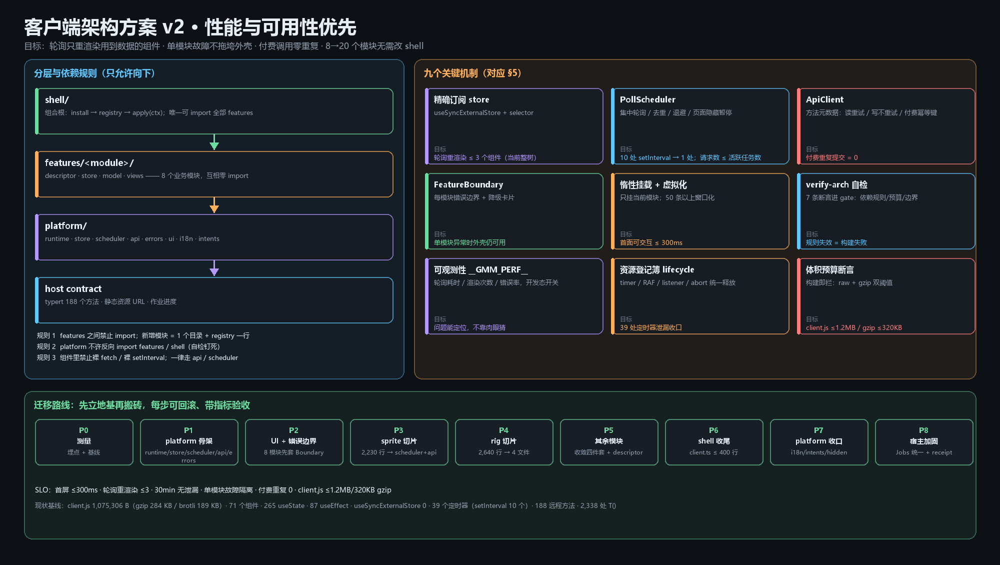

# 客户端架构方案 v2 · 性能与可用性优先

> 定位：这是**架构地基**方案，不是「怎么把 8,340 行搬出去」的搬家单。
> 旧计划（`docs/客户端拆分-计划.md`）保留为**迁移步骤参考**；两者冲突时以本文为准。
> 已落地：`src/client/ui.ts`（commit `dc4304f`）在新方案里归入 `platform/ui`。

---

## 1. 为什么重写方案

用户目标已经从「减少 client.ts 行数」升级为：**性能优先、可用性优先，为未来规模增长打地基**。
但插件有个硬约束必须先摆到桌面：

**产物体积与拆分无关。** 浏览器拿到的永远是 esbuild 内联出来的**单文件经典脚本**（无模块系统），
拆文件**不减少一个字节**。所以「性能」只能从这几处拿：

1. 少做无谓工作（惰性挂载、精确订阅、去重、缓存）
2. 少让 React 重渲染（现在每次轮询都可能重渲染整棵模块子树）
3. 少发重复请求（现在 4 个模块各自 2.5s 轮询，互不知道对方）
4. 失败时快速降级而不是拖死整页（现在没有错误边界）

「可用性」同理：不是部署冗余，而是**故障隔离 + 自愈 + 不丢状态 + 不重复花钱**。

---

## 2. 现状基线（本次实测）

### 2.1 产物与规模

| 项 | 数值 |
|---|---|
| `lib/client.js` | 1,075,306 B（gzip **284 KB**，brotli **189 KB**） |
| `src/` 总行数 | 74,870（客户端半区约 22.4k） |
| `src/client.ts` | 8,219 行（拆分前 8,340） |
| React 组件（大写函数声明） | **71** |
| `useState` / `useEffect` | **265** / 87 |
| `useMemo` / `useCallback` / `useRef` | 8 / 44 / 80 |
| `useSyncExternalStore` | **0** |
| `T()` 调用 | 2,338（词条 1,785 条） |
| `setInterval`/`setTimeout` | **39**（其中 `setInterval` 10 个：2500ms×4、5000×2、15000×2、4000、90） |
| `addEventListener` | 41 |
| `fetch(` / `try/catch` | 16 / 297 |
| 远程方法（wire.ts） | 188 |
| 模块工厂依赖数 | 16–37（`createSequenceModule` 37、`createImageModule` 31） |

### 2.2 结构性风险（对应未来增长）

| # | 风险 | 现状证据 | 放大后的后果 |
|---|---|---|---|
| R1 | **轮询 → 整树重渲染** | 0 个 `useSyncExternalStore`；任务态是组件 `useState`；2500ms 轮询 4 处 | 模块从 8 个涨到 20 个、单模块更复杂时，主线程被周期性挤占，地图/骨骼这类 canvas 编辑器掉帧 |
| R2 | **轮询风暴 / 重复请求** | 4 个模块各自 2.5s；页面切后台照跑；无退避、无去重 | 同一网关被打满，弱网时排队、超时互相挤兑 |
| R3 | **无错误隔离** | 全仓没有 `componentDidCatch`/`ErrorBoundary`（0 处） | 一个模块渲染抛错 → 整个工作台白屏，且无降级入口 |
| R4 | **付费操作无幂等护栏** | 各模块自己 try/catch + 提示，`saveConfig` 19 处、生成类 30+ 处；宿主只有 ToAPIs 有 receipt | 一次重试就是一次真实计费；未来接更多付费能力会放大 |
| R5 | **草稿覆盖** | `mergeDrafts` 16 处，靠每个模块自觉传参 | 新增模块漏用一次 → 真机「打一半被打回」 |
| R6 | **定时器/监听泄漏** | 39 timers + 41 listeners 散在各组件 `useEffect` | 切模块/重载后残留回调持续请求，越用越慢 |
| R7 | **静默丢键** | 188 个方法靠 zod schema 白名单（历史上 4 起事故） | 方法数继续涨时，漏写 schema 的概率线性上升 |
| R8 | **启动即全量构造** | 8 个模块组件在 `apply()` 时全部 `createXxxModule` 构造；`StudioPanel` 一次收 8 个组件 | 模块数翻倍后启动变慢、内存常驻变大 |

---

## 3. 设计目标（SLO）

> 数值按「本机桌面浏览器、8 个模块、真实项目数据」定；括号内是当前近似值或未知项。

| 维度 | 指标 | 目标 | 测法 |
|---|---|---|---|
| 启动 | 面板首次可交互 | ≤ 300 ms（当前未测） | 浏览器 `performance.mark` + 宿主侧首包时间 |
| 启动 | 非活动模块不挂载 | 挂载数 = 1（当前未知） | 渲染计数埋点 |
| 渲染 | 一次轮询导致的组件重渲染 | ≤ 3 个（当前可能整树） | 开发态 render counter |
| 渲染 | 编辑态交互帧 | canvas 编辑器 ≥ 50 fps，输入无卡顿 | RAF 采样 + 长任务统计 |
| 网络 | 轮询请求数（8 模块同时挂任务） | ≤ 活跃任务数（当前 4 模块各自跑） | 请求计数器 |
| 网络 | 断网/5xx 自愈 | ≤ 3 次退避内恢复，期间不刷屏报错 | 注入失败中间件 |
| 稳定性 | 单模块渲染异常 | 外壳可用、可切模块、有降级占位 | 故意抛错的 falsy fixture |
| 稳定性 | 30 分钟轮询 | DOM 节点数不增长、rAF/定时器数不增长 | 内存与计数快照 |
| 资金安全 | 付费调用重复提交 | **0**（重试只限只读方法） | 计数断言 + receipt |
| 体积 | `lib/client.js` | ≤ 1.2 MB raw / ≤ 320 KB gzip | 构建脚本预算断言 |

**关键取舍**：为了性能与可用性，可以接受**更多的文件与一层抽象**；不接受在渲染热路径上引入新开销
（例如每帧都走 Context/订阅），也不接受「为了少改代码」而保留整树重渲染。

---

## 4. 架构总览

### 4.1 分层

~~~text
┌─────────────────────────────────────────────────────────────┐
│ shell/            组合根：install → 注册表 → apply(ctx)      │
│                   唯一允许 import 全部 features 的地方        │
├─────────────────────────────────────────────────────────────┤
│ features/<module>/   descriptor · store · model · views      │
│                    8 个业务模块，互相零 import               │
├─────────────────────────────────────────────────────────────┤
│ platform/          runtime · store · scheduler · api         │
│                    ui · i18n · intents · hidden · errors     │
│                    不 import features / shell                │
├─────────────────────────────────────────────────────────────┤
│ host contract      typert 远程方法(188) · 静态资源 URL        │
└─────────────────────────────────────────────────────────────┘
~~~

### 4.2 依赖规则（用自检钉死，不靠自觉）

1. `features/*` 只准 import `platform/*`（同 feature 内部随意）。
2. `features/A` **不许** import `features/B`。
3. `platform/*` 不许 import `features/*` 或 `shell/*`。
4. 只有 `shell/` 与 `client.ts` 能 import 全部 features。
5. 组件里禁止直接 `fetch`、禁止裸 `setInterval`、禁止 `require`/第三方 import。
6. 所有远程调用必须走 `platform/api`；所有轮询必须走 `platform/scheduler`。

### 4.3 目录

~~~text
src/client.ts                     组合根（目标 200–400 行）
src/client/shell/{panel,registry,apply,errors}.ts
src/client/platform/
  runtime.ts        installRuntime(deps) + useStudio()（React 无关部分直接导出）
  store.ts          createStore()：极小可订阅 store + useStore(selector)
  scheduler.ts      PollScheduler：集中轮询、可见性、退避、并发上限
  api.ts            ApiClient：方法元数据（读/写/付费）、重试、超时、取消、inflight 合并
  errors.ts         ErrorBoundary + degrade 占位 + 全局兜底
  build.ts          构建期常量注入（版本/构建号/性能开关）
  ui.ts             已有：Chip/Btn/NumField/…（dc4304f）
  i18n.ts / intents.ts / hidden.ts / session-bridge.ts / bridges.ts
src/client/features/
  sprite/{descriptor,store,model,stages,controls}.ts
  rig/{descriptor,store,panels,timeline,assembly,wiring}.ts
  map/ iso/ music/ sfx/ image/ sequence/   现有 *-module.ts 收敛
~~~

### 4.4 每个 feature 的四件套

| 文件 | 内容 | 规则 |
|---|---|---|
| `descriptor.ts` | `{ key, icon, label, Component, hiddenKey, stages }` | shell 只读这里，新增模块不改 shell |
| `store.ts` | 该模块的状态 + 动作（拉取/提交/轮询注册） | 唯一可写状态的地方 |
| `model.ts` | 纯函数（几何、草稿合并、校验、格式化） | 不 import React，可就地单测 |
| `views.ts` | 组件，通过 `useStudio()` / `useStore` 取数 | 不直接调远程，只 dispatch 到 store |

---

## 5. 关键机制

### 5.1 精确订阅取代整树刷新（R1）

- `platform/store.ts`：`createStore<T>` 返回 `{ getState, setState, subscribe }`；`useStore(selector, isEqual?)`
  基于 `React.useSyncExternalStore`（现在 0 处 → 引入后每次轮询只重渲染**真正用到该字段**的组件）。
- 轮询结果写进 store，不在组件 `setState`；列表页用 selector 订阅数组引用，卡片用 selector 订阅单条。
- 高频路径（`TurnAxis` 播放、地图脏块、走位预览）**不进 React state**：用 `ref` + `requestAnimationFrame`，
  每帧最多画一次；状态变化走 store 但节流为「每帧合并一次」。
- 收益上限：一次轮询重渲染组件数从「整棵模块子树」降到「用到该数据的 1–3 个」。

### 5.2 PollScheduler（R2）

一个集中调度器，取代 10 个散落 `setInterval`：

- **注册**：`scheduler.watch(key, { intervalMs, run, enabled })`，返回取消句柄；组件卸载 / 模块隐藏自动退订。
- **去重**：同一 `key` 只保留一个在飞请求（inflight merge），下一次 tick 发现上次未回就跳过并计「落后」。
- **退避**：失败按 1s → 2s → 4s（上限 = 基础间隔）退避并加 jitter；成功后复位。
- **可见性**：`document.visibilityState === "hidden"` 时全暂停，回到前台立即补一次。
- **并发上限**：默认 3，超出排队；付费类方法永远不排队重试。
- **可观测**：`__GMM_PERF__.polls` 计数（次数/耗时/失败率），开发开关打开。

### 5.3 ApiClient（R3/R4/R7）

- **方法元数据表**：由 `wire.ts` 的 188 个方法生成一侧元数据（读 / 写 / 付费 / 幂等键需求），
  客户端按类执行策略：读 → 可重试（2 次，指数退避）；写 → 不自动重试；付费 → 必须 `confirm` +
  幂等键（`requestId`）+ 本地 receipt 落盘（宿主已有 ToAPIs receipt，推广到全部生成类）。
- **统一执行**：超时（默认 60s，长任务走作业轮询而不是长请求）、`AbortController` 取消、错误归一化
  （`{ code, message, retriable, requestId }`）—— 各处不再各写 `try/catch + msg()`。
- **schema 护栏**：漏写 schema 仍是历史事故源；在自检里增加「新增方法必须有 payload/result 声明」，
  并在客户端元数据表里同源于 `wire.ts`，一处漏了另一处会当场失败。

### 5.4 故障隔离与自愈（R3）

- 每个 feature 的根组件包一层 `<FeatureBoundary module="map">`：捕获渲染/生命周期异常 → 渲染降级卡片
  （「该模块暂时不可用，可切到其它模块 / 重试」），并上报一次（`__GMM_PERF__.errors`）。
- `shell` 再包一层总边界：连外壳都炸时才显示最简降级页（不做白屏）。
- `apply(ctx)` 整个过程 fail-open：任何子服务缺失（locale/sessions/remote）只降级该能力，不阻断挂载。
- 轮询/请求失败只影响对应卡片（局部 error 状态），不冒泡成整页错误。

### 5.5 惰性挂载与虚拟化（R8/R1）

- **模块级**：只有当前页签的模块 `Component` 被挂载；其余保持 descriptor 但**不渲染**。
- **任务级**：作业列表超过 50 条启用窗口化（固定行高、只渲染可视区 ±buffer）；不引第三方库，40 行实现。
- **重组件**：骨骼时间线、地图大图的 `useMemo` 只在依赖变化时算；`React.memo` 按「数据引用 + 版本号」比较。
- **图片**：`loading="lazy"`、`decoding="async"`，避免一次性解码几十张缩略图。

### 5.6 资源登记与生命周期（R6）

- `platform/lifecycle.ts`：`useResources()` 统一登记 timer / RAF / listener / abort，卸载时一次性释放；
  代码里出现裸 `setInterval` 由架构自检拦下（见 5.9）。
- 客户端每次加载都是全新模块图，没有宿主那套 `disposed` 陷阱；但**定时器跨重载不会自动消失**，
  因此必须在卸载时清理（当前有 39 处盲区）。
- 宿主侧同理：`activate*` 复位约定保留，新增任务管理器必须挂到 `ctx.effect` 的 dispose 上。

### 5.7 体积与启动（R8）

- 预算断言：raw ≤ 1.2 MB、gzip ≤ 320 KB（当前 1.05 MB / 284 KB，只剩约 12% 余量）。
- 不做动态 import（宿主没有模块加载器，分片需要宿主支持多脚本注入，列为未来项，不在本版）。
- 启动期不做业务计算：descriptor 注册只放常量；模块构造推迟到首次挂载。

### 5.8 可观测性（性能与可用性都要能告警）

- 开发构建提供 `window.__GMM_PERF__`：`{ polls: {count, ms, failures}, renders: Map<组件,次数>, errors: [] }`。
- 生产构建保留极轻量计数（只统计失败与超时），随错误一起上报给宿主日志。
- 每个 feature 的性能面板可由开关打开（默认关闭，零开销）。

### 5.9 架构适配度自检（fitness functions）

新增 `scripts/verify-arch.mjs`（进 `gate` 核心集），断言：

| # | 断言 |
|---|---|
| 1 | `features/*` 不 import 其它 `features/*` |
| 2 | `platform/*` 不 import `features/*`、`shell/*` |
| 3 | 客户端源码没有裸 `setInterval`/`fetch(`（除 platform 允许的文件） |
| 4 | 每个 feature 有 `descriptor.ts` 且在 registry 注册 |
| 5 | `lib/client.js` 体积在预算内 |
| 6 | 没有新增第三方 import（`verify-tools` 已有，保持） |
| 7 | 每个 feature 根组件被 `FeatureBoundary` 包裹 |

只有**能自动拦住**的规则才算地基；写在文档里靠自觉的规则，一年后必然失效。

---

## 6. 宿主半区（Node）配套加固

客户端只占一半；规模增长后宿主是更可能的瓶颈：

| 项 | 现状 | 目标 |
|---|---|---|
| 任务表 | `pipeline/seqgen/riggen/musicgen/sfxgen` 各自管理 | 统一 `Jobs` 服务：状态、取消、续跑、导出 receipt |
| 并发 | 各模块自己闸门 | 全局并发池（ffmpeg 2–4、生成类按账号配额），超限排队并给出预计等待 |
| 付费安全 | ToAPIs 有 receipt；其它生成类无 | 所有付费调用写 receipt（requestId → 结果），重启后拒绝重复提交 |
| 长任务 | 轮询靠客户端 | 作业进度落盘，客户端刷新后用同一个 jobId 续订 |
| 大 payload | `mapPlan` 等按视口查询（已做对） | 保持增量协议；新增方法走「按需区间 + revision」 |
| 自检 | 22 个脚本 | 增加 `verify-jobs`（并发/续跑/receipt）与 `verify-arch` |

---

## 7. 迁移路线（先立地基，再搬砖）

原则：**每一步都能独立回滚、都带指标验收**；指标未达标不进下一步。

| 阶段 | 内容 | 验收（除 362/217/9 全绿外） |
|---|---|---|
| **P0 测量** | 接入 `__GMM_PERF__` 与渲染计数；跑出「首屏 / 轮询重渲染数 / 30 分钟 DOM 增长」基线 | 基线数据写入本文件 §2 |
| **P1 platform 骨架** | `runtime` + `store` + `scheduler` + `api` + `errors`；先不迁移调用点 | 骨架自带单测式自检（verify-arch 前 6 条） |
| **P2 Ui 与错误边界** | 其余 ui 组件入 `platform/ui`；8 个模块先套 `FeatureBoundary`（行为不变） | 故意抛错仅影响单模块 |
| **P3 sprite 切片** | 2,230 行 → `features/sprite`；4 个阶段改 `scheduler + api + store` | 一次轮询重渲染 ≤ 3；轮询请求数下降 |
| **P4 rig 切片** | 2,640 行 → 4 文件；时间线渲染走 rAF 批处理 | 编辑器 ≥ 50 fps |
| **P5 其余模块** | map/iso/music/sfx/image/sequence 收敛为四件套 + descriptor | 开关模块无需改 shell |
| **P6 shell 收尾** | registry + panel + apply；`client.ts` ≤ 400 行 | 新增一个「假模块」只加 1 个目录 + 1 行注册 |
| **P7 platform 收口** | i18n/intents/hidden/session-bridge 迁入 platform | verify-arch 全绿 |
| **P8 宿主加固** | Jobs 统一 + 并发池 + receipt | verify-jobs 全绿；重复提交 0 |

---

## 8. 风险与「明确不做」

**做**：store + 精确订阅、集中调度、错误边界、ApiClient 元数据、架构自检、惰性挂载、虚拟列表。

**不做（及理由）**：

| 不做 | 理由 |
|---|---|
| 引第三方状态库（zustand/redux） | 客户端不许 import 第三方；自写 60 行 store 足够 |
| 动态 import / 分包 | 宿主只注入单脚本；除非宿主支持多 chunk，否则不可行 |
| Web Worker 跑压缩/解码 | 需要额外脚本与宿主路由支持，收益在图片解码，优先级低于渲染问题 |
| 一次性大重构 | 无法定位回归；按 P0–P8 渐进，每步回滚 |
| 在渲染热路径用 Context 传高频数据 | Context 变更会重渲染全部消费方；高频数据走 store selector/ref |

**主要风险**：

1. `useSyncExternalStore` 引入后订阅粒度过粗 → 仍整树刷新。对策：selector 返回原始值 + `Object.is` 比较，卡片级订阅。
2. 调度器成为单点：它自己崩了就全停。对策：调度器内部 try/catch，单任务异常隔离并计数。
3. ApiClient 元数据表与 `wire.ts` 漂移。对策：由 `wire.ts` 派生（同源），漂移即自检失败。
4. 迁移期间新旧两套路径并存（一半轮询在旧 `setInterval`、一半在 scheduler）→ 双倍请求。对策：P3 起每迁一个模块就删掉旧定时器，验收里看请求计数。

---

## 9. 附录 A：测量方法

| 指标 | 方法 |
|---|---|
| 首屏可交互 | 浏览器：`performance.mark('gmm:mount')` → `mark('gmm:interactive')` 差值；宿主侧记录脚本请求到响应 |
| 轮询重渲染数 | 开发态给每个组件包 `withRenderCount(name)`，一张表打印「上次轮询 → 哪些组件重渲染」 |
| 轮询请求数/耗时 | `ApiClient` 埋点：method、ms、status；汇总到 `__GMM_PERF__.polls` |
| 帧率 | 编辑器内 RAF 采样 1s 窗口，`__GMM_PERF__.fps` |
| 内存/泄漏 | 30 分钟脚本化操作后取 `performance.memory` 与 DOM 节点数、定时器数（调度器自报） |
| 故障隔离 | 注入 `throw` 的 feature fixture，断言外壳仍渲染、其它模块可切换 |
| 资金安全 | mock 网关记录调用次数，断网重试场景断言付费方法计数 = 1 |

## 10. 附录 B：评审 checklist（提交前自查）

- [ ] 新增状态在 feature store，不在组件 `useState`（高频路径 ref+rAF 例外，需注释说明）
- [ ] 新增远程调用走 `platform/api`，付费方法带 `requestId` + confirm
- [ ] 新增轮询走 `scheduler.watch`，带 `key` 与卸载取消
- [ ] 新增模块有 `descriptor.ts`，shell 零改动
- [ ] 新增组件在 `FeatureBoundary` 内；错误有降级文案
- [ ] 大列表/大图走虚拟化或惰性；图片 `loading=lazy`
- [ ] `verify-arch` 通过，`lib/client.js` 体积未超预算
- [ ] 文案走 `T()`，词条进 EN 表（verify-i18n 兜底）
